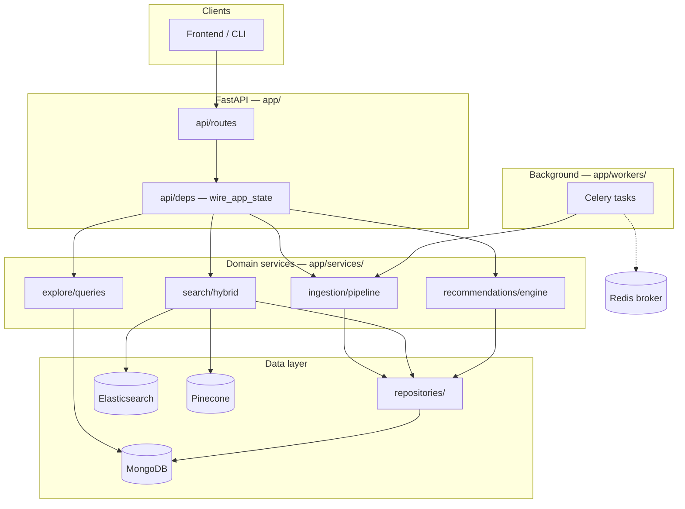

# Citexis

Hybrid academic paper discovery: **MongoDB** (metadata) + **Pinecone** (semantic search) + **Elasticsearch** (keyword), with a **React** frontend and optional **Celery + Redis** for API-only background jobs.

## Architecture

### System overview

Citexis splits work across three stores and two runtimes:

| Store / runtime | Role |
|-----------------|------|
| **MongoDB** | Canonical paper metadata, embedding status, user interactions |
| **Elasticsearch** | BM25 keyword search over title/abstract |
| **Pinecone** | Text records in `papers-abstract`; index embeds server-side |
| **FastAPI** | HTTP API, dependency wiring, request handling |
| **Celery + Redis** | Background ingestion and indexing (retries, bulk import) |



### Layered design

Requests flow **top-down**; each layer has a single responsibility so you can extend one concern without touching unrelated code.

```
HTTP request
    → api/routes/          # Thin handlers: validate input, call service, return schema
    → api/deps.py          # FastAPI Depends + app.state singletons (wired at startup)
    → services/            # Business logic (search, ingest, recommend, explore)
    → repositories/        # MongoDB queries only — no ES/Pinecone here
    → db/                  # Connection clients (Motor, AsyncElasticsearch, Pinecone)
```

| Layer | Path | Responsibility |
|-------|------|----------------|
| **Routes** | `app/api/routes/` | REST endpoints; use typed deps from `deps.py` |
| **Schemas** | `app/core/schemas/` | Pydantic request/response models shared across API and workers |
| **Services** | `app/services/` | Orchestration: multi-store workflows, algorithms |
| **Repositories** | `app/repositories/` | CRUD and queries against MongoDB collections |
| **DB clients** | `app/db/` | Lazy clients, index helpers, connection lifecycle |
| **Workers** | `app/workers/` | Celery tasks that reuse the same services as the API |
| **Config** | `app/config.py` | `Settings` from `.env` — all fields required, no code defaults |

Startup wiring lives in `wire_app_state()` (`app/api/deps.py`): it builds repositories, indexers, `IngestionPipeline`, `HybridSearchService`, `RecommendationEngine`, and attaches them to `app.state` for the request lifetime.

### Data flows

**Ingestion** (sync via UI/API, or async via Celery for scripts):

```
Source (OpenAlex / Crossref DOI + optional CORE enrichment)
    → normalizer          # app/services/ingestion/normalizer.py
    → MongoDB create      # paper_repository
    → Pinecone upsert_records  # server-side embed from text field
    → Elasticsearch index # elasticsearch_indexer
    → status = INDEXED    # embedding_status on paper doc
```

The **Import** page and sync API routes block until MongoDB + both indexes are updated. Async Celery endpoints remain available for bulk jobs outside the UI.

**Hybrid search**:

```
Query
    ├─ KeywordSearchService  → Elasticsearch (BM25, filters)
    └─ SemanticSearchService → Pinecone search + rerank in one call (optional)
            ↓
    reciprocal_rank_fusion (RRF)   # app/services/search/rrf.py
            ↓
    hydrate from MongoDB           # paper_repository.get_many_by_ids
            ↓
    SearchResponse
```

**Recommendations** (related papers):

```
paper_id
    ├─ ContentBasedRecommender    → Pinecone similarity
    ├─ CitationGraphRecommender   → MongoDB citation edges
    └─ CollaborativeRecommender   → user interaction history
            ↓
    weighted merge → RecommendationResponse
```

### Where to extend

| Goal | Start here |
|------|------------|
| New API endpoint | `app/api/routes/` + register in `routes/__init__.py`; add a dep in `deps.py` if you need a new service |
| New paper source | `app/services/ingestion/sources/` (implement `base.py`), call from a route or Celery task |
| Tune search | `app/config.py` (`search_*`, `pinecone_*`), `hybrid.py`, `rrf.py` |
| New recommendation signal | `app/services/recommendations/` + register weight in `engine.py` |
| Explore / browse queries | `app/services/explore/queries.py` |
| Async long jobs | `app/workers/tasks.py` — mirror API patterns with `_build_pipeline()` |
| ES index mapping | `scripts/setup_es_index.py` |
| Reconcile indexes with MongoDB | `scripts/reindex_elasticsearch.py`, `scripts/reindex_pinecone.py`, `scripts/cleanup_orphan_indexes.py` |

### Project layout

```
citexis/
├── frontend/                       # React UI (Vite + TypeScript + Tailwind)
│   └── src/
│       ├── api/client.ts           # API client
│       ├── components/             # Layout, SearchBar, PaperCard, PaperRating, …
│       └── pages/                  # Home, Paper, Related, Explore, Saved, Import, Author
├── app/
│   ├── main.py                     # FastAPI app + lifespan (wire / teardown)
│   ├── config.py                   # Settings from .env
│   ├── api/
│   │   ├── deps.py                 # Dependency injection + wire_app_state
│   │   └── routes/
│   │       ├── search.py           # POST /search (hybrid)
│   │       ├── papers.py           # CRUD, sync/async ingest, related
│   │       ├── interactions.py     # views, saves, ratings, clicks
│   │       ├── authors.py          # Author paper lists
│   │       └── explore.py          # Topic clusters, citation neighbors
│   ├── core/
│   │   ├── constants.py            # Enums (embedding status, etc.)
│   │   └── schemas/                # paper, search, user, recommendation
│   ├── db/
│   │   ├── mongodb.py
│   │   ├── elasticsearch.py
│   │   └── pinecone_client.py
│   ├── repositories/
│   │   ├── paper_repository.py
│   │   └── user_repository.py
│   ├── services/
│   │   ├── ingestion/
│   │   │   ├── pipeline.py         # ingest_one / index_paper
│   │   │   ├── normalizer.py
│   │   │   └── sources/            # openalex, crossref, core_enricher
│   │   ├── indexing/               # elasticsearch_indexer, pinecone_indexer, pinecone_text
│   │   ├── search/                 # keyword, semantic, pinecone_search, rrf, hybrid
│   │   ├── recommendations/        # content, citation, collaborative, engine
│   │   └── explore/                # topic clusters, author lists, citation DOIs
│   └── workers/
│       ├── celery_app.py
│       └── tasks.py                # index_paper_task, ingest_openalex_task, ingest_doi_task
├── scripts/
│   ├── setup_es_index.py           # Create ES index (used by es-init)
│   ├── reindex_elasticsearch.py    # Mongo → ES backfill
│   ├── reindex_pinecone.py         # Mongo ↔ Pinecone audit + backfill
│   └── cleanup_orphan_indexes.py   # Remove ES/Pinecone rows with no Mongo doc
├── tests/
└── .env.example
```

## Quick start

### Option A — Docker (recommended)

MongoDB and Pinecone stay **external** (your host MongoDB or Atlas + Pinecone API key).  
Redis and Elasticsearch run in Docker.

```bash
# 1. Configure environment (all variables required — see .env.example)
cp .env.example .env
# Edit .env: MONGODB_URI, PINECONE_API_KEY, and remaining values

# 2. Stop any old Elasticsearch container using port 9200
docker stop elasticsearch 2>/dev/null || true

# 3. Start the full stack
docker compose up --build
```

| URL | Service |
|-----|---------|
| http://localhost:5173 | Frontend |
| http://localhost:8000/docs | API docs |
| http://localhost:9200 | Elasticsearch |
| localhost:6380 (default) | Redis (host port; see `REDIS_HOST_PORT` in `.env`) |

If port **6380** is also in use, set `REDIS_HOST_PORT=6381` (or any free port) in `.env`.  
Inside Docker, api/worker always use `redis://redis:6379/0` — only the **host mapping** changes.

**Infra only** (run API/frontend on the host):

```bash
docker compose up elasticsearch redis es-init
```

Then set in `.env` for local processes:

```env
ELASTICSEARCH_URL=http://localhost:9200
REDIS_URL=redis://localhost:6380/0
MONGODB_URI=mongodb://localhost:27017
```

Use the same host port as `REDIS_HOST_PORT` in `.env` (default **6380**).

**MongoDB from containers**

| MongoDB location | `MONGODB_URI` in `.env` |
|------------------|-------------------------|
| Atlas | `mongodb+srv://...` |
| MongoDB on your Linux/Mac host | `mongodb://host.docker.internal:27017` |
| MongoDB on your Windows host | `mongodb://host.docker.internal:27017` |

### Option B — Local Python + Node

```bash
# 1. Virtual env + deps
python -m venv .venv
source .venv/bin/activate          # Linux/macOS
pip install -r requirements.txt
cp .env.example .env               # fill all values before starting

# 2. Start MongoDB locally; start Redis + Elasticsearch via Docker:
docker compose up elasticsearch redis es-init

# 3. Run API
uvicorn app.main:app --reload

# 4. Run Celery worker (separate terminal — only needed for async API imports, not the UI)
celery -A app.workers.celery_app worker --loglevel=info

# 5. Frontend (separate terminal)
cd frontend && npm install && npm run dev
```

API docs: http://localhost:8000/docs

## Frontend

React UI in `frontend/` (Vite + TypeScript + Tailwind). Nav: **Search**, **Explore**, **Saved**, **Import**.

| Route | Features | API |
|-------|----------|-----|
| `/` | Hybrid search with filters; click tracking on results | `POST /search`, `POST /interactions` (click) |
| `/papers/:id` | Detail, references, related preview, save/unsave, 1–5 rating, delete | `GET /papers/{id}`, `GET /explore/papers/{id}/neighbors`, `POST /interactions`, `DELETE /papers/{id}` |
| `/papers/:id/related` | Full related-papers list | `GET /papers/{id}/related` |
| `/explore?tag=…` | Topic clusters by venue | `GET /explore/topics` |
| `/saved` | Saved papers list, unsave | `GET /interactions/users/{id}/saved`, `DELETE …/saved/{paper_id}` |
| `/import` | Sync DOI import, OpenAlex import, manual paper form | `POST /papers/import/doi/sync`, `POST /papers/import/openalex/sync`, `POST /papers/sync` |
| `/authors/:name` | Papers by author; click tracking | `GET /authors/{name}/papers`, `POST /interactions` (click) |

User identity is a browser-local ID (`localStorage`) used for saves, ratings, and interaction history.

**With Docker** (included in `docker compose up`): http://localhost:5173

**Locally:**

```bash
cd frontend
npm install
npm run dev
```

Open http://localhost:5173 — API calls are proxied to the backend.

See [frontend/README.md](frontend/README.md) for build and env details.

## API

Base path: `/api/v1`. Interactive docs: http://localhost:8000/docs

### Search & browse

| Method | Path | Description | UI |
|--------|------|-------------|-----|
| POST | `/search` | Hybrid search (ES + Pinecone + RRF) | Search page |
| GET | `/papers/{id}` | Paper detail + top recommendations | Paper page |
| GET | `/papers/{id}/related` | Blended recommendations | Related page |
| DELETE | `/papers/{id}` | Delete paper from MongoDB + ES + Pinecone | Paper page |
| GET | `/authors/{name}/papers` | Author paper list | Author page |
| GET | `/explore/topics?tag=…` | Topic clusters by venue | Explore page |
| GET | `/explore/papers/{id}/neighbors` | Citation DOI neighbors | Paper page (references) |

### Import (sync — used by UI)

| Method | Path | Description | UI |
|--------|------|-------------|-----|
| POST | `/papers/sync` | Manual paper ingest (blocks until indexed) | Import page |
| POST | `/papers/import/doi/sync` | DOI ingest via Crossref | Import page |
| POST | `/papers/import/openalex/sync` | OpenAlex search import | Import page |

### Import (async — Celery, API/scripts only)

| Method | Path | Description |
|--------|------|-------------|
| POST | `/papers` | Queue manual paper ingest |
| POST | `/papers/import/doi` | Queue DOI ingest |
| POST | `/papers/import/openalex` | Queue OpenAlex bulk import |
| POST | `/papers/import/{source}` | Generic import (`openalex`, `crossref`) |

Requires the **worker** container (`celery -A app.workers.celery_app worker`).

### Interactions

| Method | Path | Description | UI |
|--------|------|-------------|-----|
| POST | `/interactions` | Record `view`, `save`, `click`, or `rating` | Paper page, search/author clicks |
| GET | `/interactions/users/{user_id}/saved` | List saved paper IDs | Saved page |
| DELETE | `/interactions/users/{user_id}/saved/{paper_id}` | Remove save | Saved page, Paper page |
| GET | `/interactions/users/{user_id}/papers/{paper_id}/rating` | User rating for a paper | Paper page |

## Tech choices (defaults)

| Component | Default |
|-----------|---------|
| Pinecone embed | Index-configured hosted model (server-side) |
| Queue | Celery + Redis (optional; async import endpoints only) |
| Keyword search | Elasticsearch (Docker) |
| Metadata | MongoDB (external) |
| API | FastAPI (Docker or local) |
| Vector DB | Pinecone namespace `papers-abstract` (text records + server embed) |

## Docker layout

```
docker compose up
├── elasticsearch   → port 9200 (persistent volume es_data)
├── redis           → host port 6380 by default (container 6379; volume redis_data)
├── es-init         → one-shot: creates ES index
├── api             → port 8000
├── worker          → Celery consumer (async imports; not required for UI)
└── frontend        → port 5173
```

MongoDB and Pinecone are **not** in Compose — configure them in `.env`.

## Maintenance scripts

Run from the project root via Docker (recommended) or locally with the same `.env`:

```bash
docker compose run --rm api python -m scripts.<script>
```

### Re-index Elasticsearch (fresh ES volume)

MongoDB and Pinecone keep your data, but a new Elasticsearch volume starts empty:

```bash
docker compose run --rm api python -m scripts.reindex_elasticsearch          # dry-run
docker compose run --rm api python -m scripts.reindex_elasticsearch --apply
```

### Audit / backfill Pinecone (Mongo ↔ vectors out of sync)

After failed ingests or manual MongoDB edits, verify every paper exists in Pinecone:

```bash
docker compose run --rm api python -m scripts.reindex_pinecone               # audit (exits 1 if out of sync)
docker compose run --rm api python -m scripts.reindex_pinecone --apply       # upsert missing + fix stale status
docker compose run --rm api python -m scripts.reindex_pinecone --apply --all # re-upsert every paper
```

Reports missing Pinecone IDs, `embedding_status` breakdown, and papers present in Pinecone but not marked `indexed` in Mongo.

### Clean orphaned index records (no Mongo doc)

Removes Elasticsearch and Pinecone entries whose IDs are not in MongoDB:

```bash
docker compose run --rm api python -m scripts.cleanup_orphan_indexes          # dry-run
docker compose run --rm api python -m scripts.cleanup_orphan_indexes --apply
```

## License

See [LICENSE](LICENSE).
