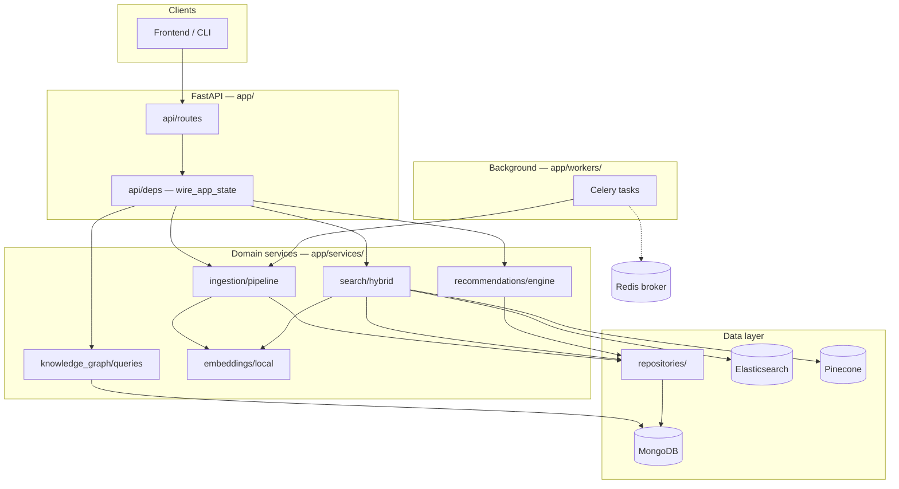

# Citexis

Hybrid academic paper discovery: **MongoDB** (metadata) + **Pinecone** (semantic search) + **Elasticsearch** (keyword), with async ingestion via **Celery + Redis**.

## Architecture

### System overview

Citexis splits work across three stores and two runtimes:

| Store / runtime | Role |
|-----------------|------|
| **MongoDB** | Canonical paper metadata, embedding status, user interactions |
| **Elasticsearch** | BM25 keyword search over title/abstract |
| **Pinecone** | One vector per paper (title + abstract + keywords) in `papers-abstract` |
| **FastAPI** | HTTP API, dependency wiring, request handling |
| **Celery + Redis** | Background ingestion and indexing (retries, bulk import) |



### Layered design

Requests flow **top-down**; each layer has a single responsibility so you can extend one concern without touching unrelated code.

```
HTTP request
    → api/routes/          # Thin handlers: validate input, call service, return schema
    → api/deps.py          # FastAPI Depends + app.state singletons (wired at startup)
    → services/            # Business logic (search, ingest, recommend, graph)
    → repositories/        # MongoDB queries only — no ES/Pinecone here
    → db/                  # Connection clients (Motor, AsyncElasticsearch, Pinecone)
```

| Layer | Path | Responsibility |
|-------|------|----------------|
| **Routes** | `app/api/routes/` | REST endpoints; use typed deps from `deps.py` |
| **Schemas** | `app/core/schemas/` | Pydantic request/response models shared across API and workers |
| **Services** | `app/services/` | Orchestration: multi-store workflows, algorithms |
| **Repositories** | `app/repositories/` | CRUD and queries against MongoDB collections |
| **DB clients** | `app/db/` | Lazy clients, index helpers, connection lifecycle |
| **Workers** | `app/workers/` | Celery tasks that reuse the same services as the API |
| **Config** | `app/config.py` | `Settings` from environment (`.env`) |

Startup wiring lives in `wire_app_state()` (`app/api/deps.py`): it builds repositories, indexers, `IngestionPipeline`, `HybridSearchService`, `RecommendationEngine`, and attaches them to `app.state` for the request lifetime.

### Data flows

**Ingestion** (single paper or arXiv bulk via Celery):

```
Source (arxiv / DOI / Semantic Scholar)
    → normalizer          # app/services/ingestion/normalizer.py
    → MongoDB create      # paper_repository
    → embed (local)       # title + abstract + tags (keywords)
    → Pinecone upsert     # pinecone_indexer → papers-abstract namespace
    → Elasticsearch index # elasticsearch_indexer
    → status = INDEXED    # embedding_status on paper doc
```

**Hybrid search**:

```
Query
    ├─ KeywordSearchService  → Elasticsearch (BM25, filters)
    └─ SemanticSearchService → embed query → Pinecone (vector, filters)
            ↓
    reciprocal_rank_fusion (RRF)   # app/services/search/rrf.py
            ↓
    hydrate from MongoDB           # paper_repository.get_many_by_ids
            ↓
    optional reranker              # app/services/search/reranker.py
            ↓
    SearchResponse
```

**Recommendations** (related papers):

```
paper_id
    ├─ ContentBasedRecommender    → Pinecone similarity
    ├─ CitationGraphRecommender   → MongoDB citation edges
    └─ CollaborativeRecommender   → user interaction history
            ↓
    weighted merge → RecommendationResponse
```

### Where to extend

| Goal | Start here |
|------|------------|
| New API endpoint | `app/api/routes/` + register in `routes/__init__.py`; add a dep in `deps.py` if you need a new service |
| New paper source | `app/services/ingestion/sources/` (implement `base.py`), call from a route or Celery task |
| Change embedding model | `EMBEDDING_MODEL` in `.env`; logic in `app/services/embeddings/local.py` |
| Tune search | `app/config.py` (`search_*` defaults), `hybrid.py`, `rrf.py`, or swap `Reranker` in `HybridSearchService` |
| New recommendation signal | `app/services/recommendations/` + register weight in `engine.py` |
| Graph / explore queries | `app/services/knowledge_graph/queries.py` |
| Async long jobs | `app/workers/tasks.py` — mirror API patterns with `_build_pipeline()` |
| ES index mapping | `scripts/setup_es_index.py` |

### Project layout

```
citexis/
├── app/
│   ├── main.py                     # FastAPI app + lifespan (wire / teardown)
│   ├── config.py                   # Settings from .env
│   ├── api/
│   │   ├── deps.py                 # Dependency injection + wire_app_state
│   │   └── routes/
│   │       ├── search.py           # POST /search (hybrid)
│   │       ├── papers.py           # CRUD, ingest, related
│   │       ├── authors.py          # Author paper lists
│   │       └── explore.py          # Topic clusters
│   ├── core/
│   │   ├── constants.py            # Enums (embedding status, etc.)
│   │   └── schemas/                # paper, search, user, recommendation
│   ├── db/
│   │   ├── mongodb.py
│   │   ├── elasticsearch.py
│   │   └── pinecone_client.py
│   ├── repositories/
│   │   ├── paper_repository.py
│   │   └── user_repository.py
│   ├── services/
│   │   ├── ingestion/
│   │   │   ├── pipeline.py         # ingest_one / index_paper
│   │   │   ├── normalizer.py
│   │   │   └── sources/            # arxiv, doi_lookup, semantic_scholar
│   │   ├── indexing/               # elasticsearch_indexer, pinecone_indexer
│   │   ├── embeddings/             # local sentence-transformers
│   │   ├── search/                 # keyword, semantic, rrf, hybrid, reranker
│   │   ├── recommendations/        # content, citation, collaborative, engine
│   │   └── knowledge_graph/        # MongoDB aggregation queries
│   └── workers/
│       ├── celery_app.py
│       └── tasks.py                # index_paper_task, ingest_arxiv_task
├── scripts/setup_es_index.py
├── tests/
└── .env.example
```

## Quick start

```bash
# 1. Virtual env + deps
python -m venv .venv
.venv\Scripts\activate          # Windows
pip install -r requirements.txt
cp .env.example .env            # fill PINECONE_API_KEY when ready

# 2. Start MongoDB, Redis, and Elasticsearch locally (see .env.example for URLs)

# 3. Create Elasticsearch index (Phase 2)
python -m scripts.setup_es_index

# 4. Run API
uvicorn app.main:app --reload

# 5. Run Celery worker (separate terminal)
celery -A app.workers.celery_app worker --loglevel=info
```

API docs: http://localhost:8000/docs

## API (Phase 1+)

| Method | Path | Description |
|--------|------|-------------|
| POST | `/api/v1/search` | Hybrid search (ES + Pinecone + RRF) |
| GET | `/api/v1/papers/{id}` | Paper detail + recommendations |
| GET | `/api/v1/papers/{id}/related` | Blended recommendations |
| POST | `/api/v1/papers` | Ingest paper (async Celery) |
| POST | `/api/v1/papers/import/arxiv` | Bulk arXiv import |
| GET | `/api/v1/authors/{name}/papers` | Author paper list |
| GET | `/api/v1/explore/topics?tag=llm` | Topic clusters |

## Build phases

1. **Foundations** — MongoDB schema + arXiv ingestion (`ingestion/`, `workers/`)
2. **Search** — Elasticsearch BM25, then Pinecone + hybrid RRF (`search/`)
3. **Recommendations** — Content → citation graph → collaborative (`recommendations/`)
4. **Knowledge graph + UI** — Aggregation queries + frontend graph (`knowledge_graph/`)

## Tech choices (defaults)

| Component | Default |
|-----------|---------|
| Embeddings | `all-MiniLM-L6-v2` (local) |
| Queue | Celery + Redis |
| API | FastAPI |
| Vector DB | Pinecone namespace `papers-abstract` (one vector per paper) |

## License

See [LICENSE](LICENSE).
